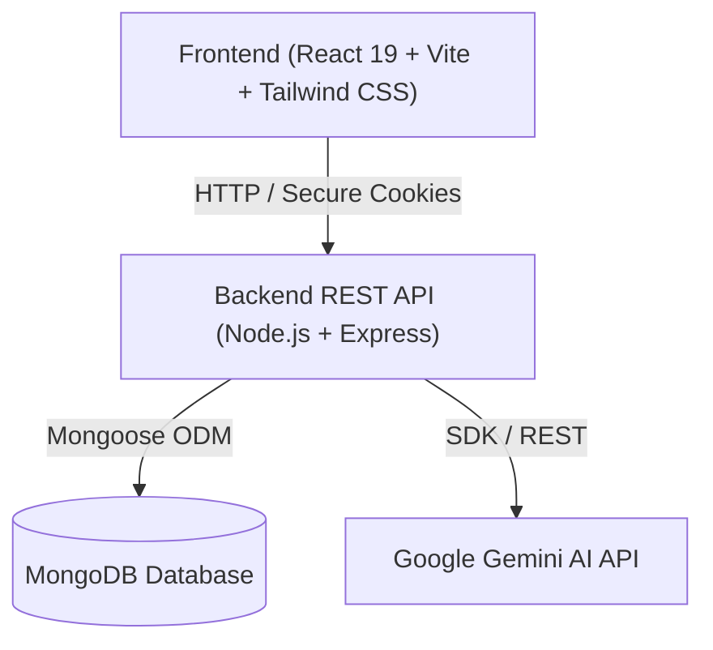

# 🚀 AI Resume Maker (MERN Stack)

A modern, full-stack, AI-driven ATS-friendly Resume Maker built using MongoDB, Express.js, React 19, Node.js, and Google Gemini AI.

---

## 🏗️ Architecture Overview



---

## 📁 Repository Folder Structure

```
ai-resume-maker/
├── package.json               # Root scripts
├── .gitignore                 # Monorepo ignore rules
├── README.md                  # Project documentation
│
├── client/                    # Frontend React 19 + Vite + Tailwind CSS
│   ├── .env.example
│   ├── .env
│   ├── index.html             # HTML entry with Inter & Outfit fonts
│   ├── vite.config.js         # Tailwind v4 & dev server proxy
│   ├── package.json
│   └── src/
│       ├── layouts/           # Navbar, Footer, Dashboard layout
│       ├── pages/             # Home, Login, Register, Dashboard, NotFound
│       ├── components/        # Reusable UI widgets & forms
│       ├── templates/         # 4 distinct ATS resume templates
│       ├── services/          # Axios instance & API callers
│       ├── context/           # State management & Auth context
│       ├── hooks/             # Custom React hooks
│       ├── utils/             # Helper formatters & PDF export helpers
│       ├── App.jsx            # React Router routes
│       ├── main.jsx           # React DOM root
│       └── index.css          # Tailwind CSS styling & custom scrollbars
│
└── server/                    # Backend Node.js & Express REST API (MVC)
    ├── .env.example
    ├── .env
    ├── package.json           # ES Modules enabled ("type": "module")
    ├── server.js              # Server bootstrapper & port listener
    ├── app.js                 # Express app configuration & middleware
    ├── config/
    │   └── db.js              # Mongoose database connection
    ├── controllers/           # Request handlers (auth, resume, ai, admin)
    ├── models/                # Mongoose schemas (User, Resume, Template)
    ├── routes/                # Express API routes
    ├── middleware/            # Auth, role check, validation, rate limiters
    ├── services/              # Gemini AI client & PDF generators
    └── utils/                 # Token helpers & response formatters
```

---

## 🛠️ Prerequisites

1. **Node.js**: v18.x or newer (Tested on v26.x).
2. **NPM**: v9.x or newer.
3. **MongoDB**: Local MongoDB instance (`mongod`) or free cloud MongoDB Atlas cluster URI.
4. **Google Gemini API Key**: From [Google AI Studio](https://aistudio.google.com/) (Required in Phase 6).

---

## 🚀 Running Phase 1

### 1. Start the Backend Server
In your first terminal:
```bash
cd server
npm run dev
```
- Server starts at `http://localhost:5000`
- Health check: `http://localhost:5000/api/health`

### 2. Start the Frontend Client
In your second terminal:
```bash
cd client
npm run dev
```
- Client launches at `http://localhost:5173`
- Includes live API health badge, landing page, and routed views.
